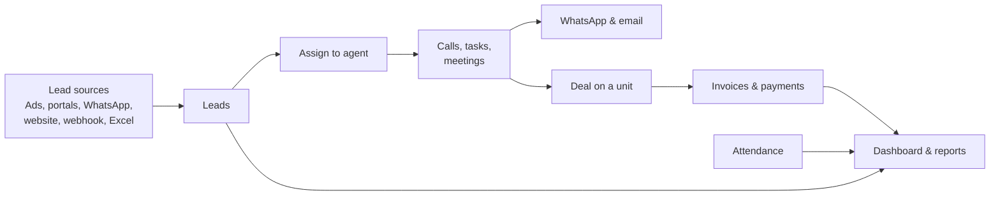

# Software Requirements Specification (SRS)

**Dubai Real Estate CRM** · Version 1.2 · 11 October 2026
Based on the developer requirements brief (29 September 2026), stakeholder feedback (11 October 2026) and the subscription and billing decisions (11 October 2026).

---

## What changed in version 1.2

| # | Decision | What changed in this document |
|---|---|---|
| 1 | We sell the CRM to brokerages (B2B) and individual agents (B2C) | New section 12: plans, online sign-up, free trial, seats, payments, invoices, payment failure, cancellation and our owner console. |
| 2 | Plans and price | Solo, Team and Enterprise. AED 99 per user per month, excluding VAT, monthly or yearly. Same features in every plan. |
| 3 | Trial and sign-up | 14-day free trial; a card is required. Trade licence + RERA ORN (brokerage) or RERA BRN (agent) required at sign-up. |
| 4 | Payments | Stripe for cards; bank transfer allowed for every plan. 14 days' grace if payment fails, then read-only. |
| 5 | WhatsApp | Each company pays Meta directly for WhatsApp; it is not on our invoice. |
| 6 | Version 1 | Everything in this document is in version 1. |

## What changed in version 1.1

| # | Stakeholder feedback | What changed in this document |
|---|---|---|
| 1 | Remove respond.io | WhatsApp connects directly to the official WhatsApp Business Platform (Meta). Section 5. |
| 2 | Lead moves to another agent if not answered in a set time | New rule: not answered in 10 minutes (adjustable) → next agent in the team → after the whole team → Admin. Section 3. |
| 3 | Portals and a general webhook | Property Finder, Bayut and Dubizzle added. One general webhook connects any other source (website, Google Sheets, Excel, other systems). Section 11. |
| 4 | Remove Zoom and Calendly if costly | Replaced with free options: Google Meet / Microsoft Teams links and a booking page built into the CRM. Section 3. *To confirm.* |
| 5 | Share a lead with a secondary user | A lead can be shared with other users, with "view only" or "can edit" access. Section 2. *Access choice to confirm.* |
| 6 | Repeat enquiry goes to the previous agent | A repeat enquiry is added to the existing lead and goes to the same agent with a "Re-enquired" notification. Duplicates tab removed. Section 2. *To confirm.* |
| 7 | Team: manage users, team hierarchy, roles | Team menu has three parts: Manage users (incl. turning lead assignment on/off), Manage team, Roles and permissions (custom roles such as Sales, Basic, HR). Section 4. |
| 8 | Remove Property Listings menu | Menu removed. Units are managed inside each project. Section 1 and 6. |
| 9 | Only Admin can export | Lead, report and attendance exports are Admin only. Section 13. |
| 10 | Remove auto-close | Leads are never closed automatically. The brokerage team decides. Section 2. |

---

## What we are building

A CRM for Dubai real estate brokerages that works on computer and phone. It captures leads, assigns them to agents, tracks every call and message, books meetings, manages projects and invoices, records attendance and produces reports.

It is sold to **brokerages (B2B)** and to **individual agents (B2C)**. Customers sign up online, try it free for 14 days and pay AED 99 per user per month. Each customer's data is kept completely separate.

**Version 1 includes everything in this document.** It is built and tested in 3 phases and launched when all are done:

| Phase | Includes |
|---|---|
| Phase 1 | Leads, tasks, team and permissions, dashboard, reports, Meta lead ads, Excel import, subscriptions, billing and sign-up |
| Phase 2 | WhatsApp, email, all other integrations (ad platforms, Property Finder, Bayut, Dubizzle, general webhook, calendars, booking page) |
| Phase 3 | Projects and units, invoices and purchase orders, attendance |

---

## Who uses it

| Role | Can see |
|---|---|
| Director | Whole company |
| General Manager | Their divisions |
| Sales Manager | Their teams |
| Team Leader | Their team |
| Sales Agent | Their own leads, and leads shared with them |
| Admin | Whole company (setup, users, exports; no finance approval) |
| Finance | Invoices, purchase orders and payments for the whole company |

These are the built-in roles. Admins can create more roles, for example Sales, Basic or HR, and choose exactly what each one can do (section 4).

An individual agent (B2C) has one user with Director and Admin access.

Our own team (the platform team) uses a separate **owner console** to run the business: customers, payments and plans. They are not users of any customer company and cannot see its leads or messages (section 12).

---

## 1. Screens and navigation · Phase 1

1. Left menu: Dashboard, Leads, Tasks and Calendar, WhatsApp and Email, Projects, Invoices and Purchase Orders, Reports, Attendance, Team, Organization Profile (with Billing for the Admin), Configuration and Integrations. Users only see what they are allowed to use.
2. Lead tabs: All, My Leads, Shared with Me, Team Leads, Unassigned, Deleted, New, Pending, Scheduled, Overdue, Cold.
3. Global search by name, phone or email from any screen.
4. Every list has date filters, saved filters, choose-your-columns and bulk actions.
5. Export button only for users allowed to export (Admin by default).
6. Layout follows the CRM screenshot attached to the brief.

## 2. Leads · Phase 1

**Getting leads in**

1. Sources: Meta ads, Excel/CSV import and manual entry (Phase 1); Google, LinkedIn, Snapchat, TikTok, Property Finder, Bayut, Dubizzle, WhatsApp and the general webhook (Phase 2).
2. For each enquiry we keep the source, campaign, ad set, ad, form and submission IDs, the original form answers and the original submission time.
3. The same submission is never imported twice.
4. Excel import shows a preview, checks phone and email, and lists rejected rows with the reason.

**Repeat enquiries (no duplicate leads)**

5. When an enquiry arrives with the same phone or email as an existing lead, no new lead is created. The enquiry is added to the existing lead's timeline as "Re-enquired".
6. The lead stays with the previous agent, who gets a notification: "Re-enquired via [source]".
7. If that lead was Lost or Invalid, it reopens in Follow-up with the same agent.
8. If the previous agent is deactivated or has lead assignment turned off, the lead is assigned by the normal rules.
9. When someone types a new lead by hand that already exists, they see "This lead already exists, owned by [agent]" and can open it instead.

**Lead list**

10. Columns: name, phones, email, country, project, source, campaign, form, agent, priority, stage, latest note, next follow-up, lead score.
11. Search and filter by name, phone, email, project, campaign, agent, team, stage, budget, source and date.
12. Best leads first: sorted by lead score, then next follow-up.

**Lead page**

13. One timeline of everything: enquiries and re-enquiries, calls, notes, stage and owner changes, WhatsApp, emails, meetings, files, EOI, booking, invoices.
14. From the lead page an agent can add a note, log a call, change stage, set priority, plan the next action and attach files.
15. A lead can be linked to several projects, and to one chosen unit for the deal.

**Sharing a lead with other users**

16. The owner, or a manager above them, can share a lead with one or more secondary users.
17. For each person they choose the access: **View only** or **Can edit** (notes, calls, tasks, messages, stage). Only the owner and managers can reassign or delete.
18. Shared leads appear in the secondary user's "Shared with Me" tab. Sharing can be removed at any time. Every share and removal is logged.

**Stages and owner**

19. Stages (editable): New, Pending, Attempted, No Response, Follow-up, Warm, Hot, Qualified, Meeting Scheduled, Viewing Scheduled, EOI Submitted, Booked, Won, Lost, Invalid.
20. Every open lead must have an owner and a next follow-up date (except leads waiting in Unassigned).
21. A reason is required for Lost, Invalid and reassignment.
22. Every change is kept in history: what changed, from what, to what, by whom, when. History cannot be edited.
23. Leads are never closed or removed automatically. Only users with permission can change stage or delete, and deleted leads can be restored.

**What each tab shows**

| Tab | Shows |
|---|---|
| New / Pending | Leads in that stage |
| Shared with Me | Leads other users shared with me |
| Scheduled | Leads with an upcoming call, meeting or viewing |
| Overdue | Leads whose next follow-up date has passed |
| Cold | Leads in the No Response stage |
| Unassigned | Leads without an agent |
| Deleted | Deleted leads |

**Focus on good leads**

24. Each lead gets a score from 0 to 100 based on budget, project match, source quality and how engaged they are. The highest scores show first.

## 3. Tasks, calls and meetings · Phase 1 (calendar sync and booking page in Phase 2)

1. Day, week and calendar views of calls, meetings, viewings and personal tasks: due, overdue and done.
2. A call has: lead, agent, date, time, reminder, outcome (Answered, No answer, Busy, Wrong number, Call back) and next action.
3. Agents get reminders before tasks and an alert when a follow-up becomes overdue.

**New lead not answered: move to the next agent**

4. When a new lead is assigned, the agent has **10 minutes** (adjustable) to act on it. Any logged action counts: call, note, message or stage change.
5. If the agent does not act in time, the lead moves to the **next available agent in the same team**, who also gets 10 minutes.
6. If **every agent in the team** misses it (for example, all 3 agents of a 3-agent team), the lead goes back to the **Admin**. The Admin becomes the owner, is notified, sees the full history of who missed it and when, and can work the lead or assign it to anyone.
7. Each move is logged with the reason "No response from agent", and the agent who missed it is told.

**Meetings and viewings (no Zoom or Calendly subscription needed)**

8. Online meetings use **Google Meet or Microsoft Teams** links, created from the agent's connected Google or Microsoft account at no extra cost.
9. Each agent has a **booking page built into the CRM**. Clients pick a free slot; the meeting, link and confirmation are created automatically. Bookings, changes and cancellations update the lead.
10. Meeting confirmations are sent by email or WhatsApp.
11. An agent cannot be double-booked.
12. Clients see times in their own time zone.
13. Sync with Google Calendar or Microsoft 365.

## 4. Team and permissions · Phase 1

The Team menu has three parts.

**Manage users**

1. Admin adds users, sets their role and team, and activates or deactivates them.
2. Admin can turn **lead assignment on or off** for each user. When off, the user keeps their existing leads but receives no new ones.
3. A user's leads must be reassigned before the user is deactivated.

**Manage team**

4. Build the hierarchy: Director → General Manager → Sales Manager → Team Leader → Sales Agent.
5. Create divisions and teams, and move people between them.

**Roles and permissions**

6. Built-in roles: Director, General Manager, Sales Manager, Team Leader, Sales Agent, Admin, Finance.
7. Admin can create new roles (for example Sales, Basic, HR) and tick exactly which actions each role can do and which records it can see (own, team, division or whole company).

**Lead assignment**

8. Automatic assignment: round-robin, or rules by project, campaign, language, location and source. Agents on leave, unavailable or with assignment turned off are skipped.
9. Leads that match no rule go to Unassigned.
10. Every reassignment is logged: old agent, new agent, who, when, why.

## 5. WhatsApp and email · Phase 2

1. WhatsApp and email conversations show on the lead's timeline; agents reply from there.
2. Send approved templates: brochures, follow-ups, meeting confirmations.
3. Bulk campaigns: pick an audience, template and schedule; send a test; manager approves before sending.
4. Message status: sent, delivered, failed, replied, opted out.
5. Campaign report: sent, delivered, failed, replied, opted out.
6. Consent and opt-out are recorded per channel. Opted-out people are never messaged.
7. WhatsApp connects directly to the official WhatsApp Business Platform (Meta). No third-party inbox is used.
8. Each company connects its own WhatsApp Business account and pays Meta directly for messages. WhatsApp can be connected once our team has verified the company's licence (section 12).

## 6. Projects and units · Phase 3

1. Records for developers, projects, buildings and units. Units are listed and filtered inside each project.
2. Unit details: location, type, bedrooms, size, view, floor, price, payment plan, handover date, images, brochure, floor plan.
3. Unit status: Available, On Hold, Booked, Sold. Only allowed roles can change status or price.
4. Price and status changes are kept in history.
5. A deal links a lead to a unit and holds the offer, meetings, EOI, booking and invoices.

## 7. Invoices and purchase orders · Phase 3

1. Sales invoices, purchase invoices and purchase orders, linked to a lead, project, unit, deal, client, developer or vendor.
2. Each has a unique number, dates, currency, line items, VAT, totals, payment terms, attachments and approval history.
3. Status: Draft, Approved, Sent, Partially Paid, Paid, Overdue, Cancelled, Refunded.
4. Only drafts can be edited. Approved documents are cancelled and reissued, never changed.
5. Every document can be downloaded as PDF.
6. Record payments and refunds; the balance updates automatically.
7. Agent commissions per deal, with developer commission invoices attached.
8. Only Finance and Director can approve or cancel financial documents. Every change is logged.

## 8. Reports · Phase 1 (some in Phase 2 and 3)

1. Every report filters by date, project, source, campaign, team and agent. Excel and CSV exports match the screen exactly.
2. Lead reports: all leads; new, pending, scheduled, overdue, untouched and lost; re-enquiries; by source, project, campaign and form.
3. Marketing: spend, leads, cost per lead, qualified leads, cost per qualified lead. Ad spend is imported daily from ad accounts or entered manually.
4. Performance: agents, call outcomes, response times and missed leads, lead funnel, meetings and viewings.
5. Events and roadshows: create events and tag leads to them; report on leads, meetings, bookings and cost per event.
6. WhatsApp and email campaigns, integration failures (Phase 2).
7. Meta check: compares leads in Meta with leads in the CRM and recovers any missing ones (Phase 2).
8. Sales by project and unit, invoices, payments, balances, commissions, attendance (Phase 3).
9. Only Admin can export (lead, report and attendance exports). Every export is logged: who, what, filters, when.
10. Large exports run in the background; the user is notified when ready.

## 9. Attendance · Phase 3

1. Check in and out on the phone with a live photo and time; location only if the company enables it and the user allows it.
2. Status: Present, Late, Absent, Leave, Half Day, Work From Home.
3. Set office hours, grace time, weekends, holidays and leave rules.
4. Employees request corrections; managers approve. Original and corrected entries are both kept.
5. Monthly report per employee and team (Excel export by Admin).
6. Users on leave don't receive new leads.

## 10. Dashboard · Phase 1

1. Each role sees its own view: agent sees own work, manager sees teams, GM and Director see the company.
2. Pie charts: leads by source, project and stage.
3. Funnel: lead → contacted → qualified → meeting → EOI → booking → sale.
4. Bar charts by agent, project and campaign; line charts for leads, spend, qualified leads and sales over time.
5. Number cards: total, new, untouched, overdue, re-enquired, meetings today, qualified, EOIs, bookings, sales value, unpaid invoices.
6. Filters: date, team, agent, project, campaign. Click any number to see the leads behind it.
7. Numbers are at most 5 minutes old.

## 11. Settings and integrations · Phase 2 (settings in Phase 1)

1. One screen to connect: Meta, Google Ads, LinkedIn, Snapchat, TikTok, Property Finder, Bayut, Dubizzle, WhatsApp, email, Google (Calendar and Meet), Microsoft 365 (Calendar and Teams), and the general webhook.
2. **General webhook:** a secure link that any system can send leads to: the website, Google Sheets, Excel (via Power Automate), Make.com or any other tool. Admin maps the incoming fields to CRM fields (name, phone, email, project…) once, and every new row or form becomes a lead.
3. For each connection: account, status, last sync, records received, failures, error details, and Test, Retry, Disconnect buttons.
4. Failed incoming data is retried automatically, then shown for manual retry.
5. Admins can set: stages, reasons, assignment rules, response time (10 minutes by default), teams, work hours, templates, currencies, invoice numbering, scoring and report access.

---

## 12. Subscriptions, billing and sign-up · Phase 1

**Plans and prices**

| Plan | For | Price |
|---|---|---|
| Solo | One independent agent (B2C) | AED 99 per user per month |
| Team | Brokerages of any size; no minimum number of users | AED 99 per user per month |
| Enterprise | Large brokerages, through our sales team | Custom price, priority support and custom setup |

1. Every plan has the same features.
2. Prices exclude 5% VAT; VAT is added on the invoice.
3. Billing is monthly or yearly. *Yearly price to confirm (draft: 10 months' price, 2 months free).*
4. **WhatsApp:** each company connects its own WhatsApp Business account and pays Meta directly. It is not on our invoice.

**Signing up**

1. A new agent or brokerage signs up on our website: chooses a plan, the number of users and monthly or yearly billing.
2. A brokerage must enter its **trade licence number and RERA office number (ORN)**. An individual agent must enter their **RERA broker card number (BRN)**. A copy can be uploaded.
3. The email address is confirmed with a 6-digit code.
4. A **card is required** to start the **14-day free trial**. The first charge is at the end of the trial unless the customer cancels. Card details go straight to Stripe; the CRM never sees or stores them.
5. The company is created with the default roles, stages and settings, and the person who signed up becomes its Admin.
6. Our team checks the licence or RERA number. WhatsApp can be connected only after this check.
7. **Enterprise:** the customer fills in a "Talk to sales" form; our team sets up the company with the agreed price and invites its Admin.

**Seats (number of users)**

1. Each active user uses one seat. Invited users don't use a seat until they accept.
2. The Admin can add seats at any time; the extra seats are charged for the rest of the current period.
3. Fewer seats take effect at the next renewal and can never be fewer than the active users.
4. When all seats are used, adding or reactivating a user asks the Admin to add a seat first.

**Paying**

1. By **card** (charged automatically every month or year) or by **bank transfer** (allowed on every plan).
2. Bank transfer: the invoice is emailed with our bank details. The Admin enters the transfer reference and can attach the receipt; our team confirms when the money arrives.
3. Every charge comes with a UAE tax invoice (5% VAT), which the Admin can download from the Billing screen.

**If a payment fails**

1. The Admin gets an email and the CRM shows a banner: "Payment failed, please update your card or pay by transfer."
2. For **14 days** (grace period) everything keeps working, with reminders.
3. Still unpaid after 14 days: the company becomes **read-only**. Users can view and export but cannot add or change anything. New leads from Meta, portals and the webhook are still saved, so nothing is lost.
4. Paying reactivates the company at once. Data is never deleted while a company is unpaid.

**Cancelling**

1. The Admin can cancel at any time. The CRM keeps working until the end of the paid month or year. There is no refund for a period that has started.
2. The Admin can undo the cancellation before the period ends.
3. After the end, all data can still be exported for **90 days**, then it is deleted permanently.

**Owner console (our team only)**

1. A separate login with a two-factor code. Our team members are not users of any customer company.
2. Shows every company with its plan, seats, status (trial, active, payment failed, read-only, cancelled), usage and invoices, plus monthly income, trials ending soon and unpaid invoices.
3. Our team can: verify licences, confirm bank transfers, extend a trial or grace period (with a note), set an Enterprise price, suspend a company (for example for abuse), change plans and prices, and follow up sales enquiries.
4. Our team cannot see a company's leads or messages.
5. Every action in the owner console is logged.

**Support**

1. WhatsApp and email, Sunday to Friday, 9 am to 6 pm UAE time.
2. Free help importing old leads (Excel or another CRM) for Team and Enterprise customers.

---

## 13. Who can do what (default)

Admins can change these defaults and create new roles (section 4).

✓ = allowed · — = not allowed · Own / Team / Div / All = which records

| Action | Director | GM | Sales Mgr | Team Leader | Agent | Admin | Finance |
|---|---|---|---|---|---|---|---|
| View leads | All | Div | Team | Team | Own + shared | All | — |
| Create leads | ✓ | ✓ | ✓ | ✓ | ✓ | ✓ | — |
| Edit leads | ✓ | ✓ | ✓ | ✓ | Own + shared (can edit) | ✓ | — |
| Delete / restore leads | ✓ | ✓ | ✓ | — | — | ✓ | — |
| Assign leads | ✓ | ✓ | ✓ | ✓ | — | ✓ | — |
| Share a lead | ✓ | ✓ | ✓ | ✓ | Own | ✓ | — |
| Import leads | ✓ | ✓ | ✓ | — | — | ✓ | — |
| Export leads, reports, attendance | — | — | — | — | — | ✓ | — |
| Send WhatsApp / email | ✓ | ✓ | ✓ | ✓ | ✓ | — | — |
| Create bulk campaign | ✓ | ✓ | ✓ | — | — | — | — |
| Approve bulk campaign | ✓ | ✓ | — | — | — | — | — |
| Manage projects and units | ✓ | ✓ | — | — | — | ✓ | — |
| Change unit status or price | ✓ | ✓ | ✓ | — | — | ✓ | — |
| Create invoices / POs | ✓ | — | — | — | — | — | ✓ |
| Approve / cancel invoices / POs | ✓ | — | — | — | — | — | ✓ |
| View attendance | All | Div | Team | Team | Own | All | — |
| Approve attendance and leave | ✓ | ✓ | ✓ | ✓ | — | ✓ | — |
| Manage users, teams, roles | ✓ | — | — | — | — | ✓ | — |
| Turn lead assignment on/off for a user | — | — | — | — | — | ✓ | — |
| Settings and integrations | ✓ | — | — | — | — | ✓ | — |
| View audit log | ✓ | — | — | — | — | ✓ | — |
| View plan, seats and our invoices | ✓ | — | — | — | — | ✓ | — |
| Change plan, seats, payment method; cancel | — | — | — | — | — | ✓ | — |

---

## 14. Quality standards

| Area | Standard |
|---|---|
| Security | Login with two-factor code for everyone. Permissions checked on the server for every action. |
| Data separation | One customer can never see another customer's data. |
| Encryption | All data encrypted in transit and at rest, including backups. |
| Audit | Logins, changes, deletions, shares, exports and permission changes are logged and cannot be edited. |
| Uptime | 99.5% a month. One server failing does not stop the system. |
| Speed | Lead list and lead page open in under 1 second. New leads appear within 1 minute. |
| Backups | Daily, with restore to any moment in the last 14 days. At most 5 minutes of data lost; back online within 1 hour. |
| Growth | Can grow to 1 million users by adding server capacity, without rewriting code. |
| Data location | Personal and financial data stays in the UAE. |
| Privacy | Follows UAE data protection law: consent, opt-out, data export and deletion on request. A cancelled company's data is deleted 90 days after the end of its subscription. |
| Payments | Card details are handled only by Stripe (PCI DSS certified); the CRM never stores them. |
| Phone use | Every screen works on a phone. |
| Environments | Separate test (staging) and live (production) systems. |
| Handover | Company owns the data, source code, database design, API documentation, deployment guide; staff training included. |

## 15. Acceptance tests

The system is accepted when these pass on the test system:

1. A sample lead from every connected source, including the general webhook and Dubizzle, arrives with all its IDs and form answers.
2. A repeated submission is not imported twice.
3. A repeat enquiry from an existing contact is added to the existing lead, stays with the same agent, and the agent gets a "Re-enquired" notification.
4. A lead missing from the CRM but present in Meta is found and recovered.
5. Leads are assigned correctly by round-robin and rules, skipping unavailable agents and agents with assignment turned off.
6. A lead not answered in 10 minutes moves to the next agent in the team; when the whole team misses it, it goes to the Admin.
7. A shared lead is visible to the secondary user, who can only edit when given "Can edit" access.
8. A client books through the CRM booking page; the Google Meet / Teams link, calendar entry and confirmation are created, and changes update the lead.
9. An opted-out contact is left out of a bulk campaign.
10. An invoice linked to a lead, unit and deal shows on the lead timeline; payments update the balance.
11. An attendance correction keeps both the original and corrected entries.
12. Only Admin can export; Excel exports match the screen totals for every report.
13. A user cannot see or change data outside their permissions, or another customer's data.
14. A new agent signs up online with a RERA BRN, confirms the email, saves a card and starts a 14-day trial; a brokerage cannot sign up without trade licence and RERA ORN.
15. With all seats used, a new user cannot be activated until the Admin adds a seat; the extra seat appears on the next invoice.
16. A failed card payment gives 14 days' grace with reminders; after that the company is read-only, and paying reactivates it at once.
17. A bank transfer is confirmed in the owner console and the invoice is marked paid.
18. Every charge produces a tax invoice with 5% VAT that the Admin can download.
19. A cancelled company keeps working to the end of the paid period, can export its data for 90 days, and is then deleted.

## 16. Not in version 1

- Native iPhone / Android apps (the web app installs on phones instead)
- Arabic language
- Full accounting (ledger, VAT returns, bank reconciliation)
- Publishing listings to property portals
- Call recording
- Zoom and Calendly (replaced by free Google Meet / Teams and the CRM booking page)
- Automatic closing of leads

---

| Approved by | Name | Date |
|---|---|---|
| Solution Architect | | |
| Stakeholder | | |
